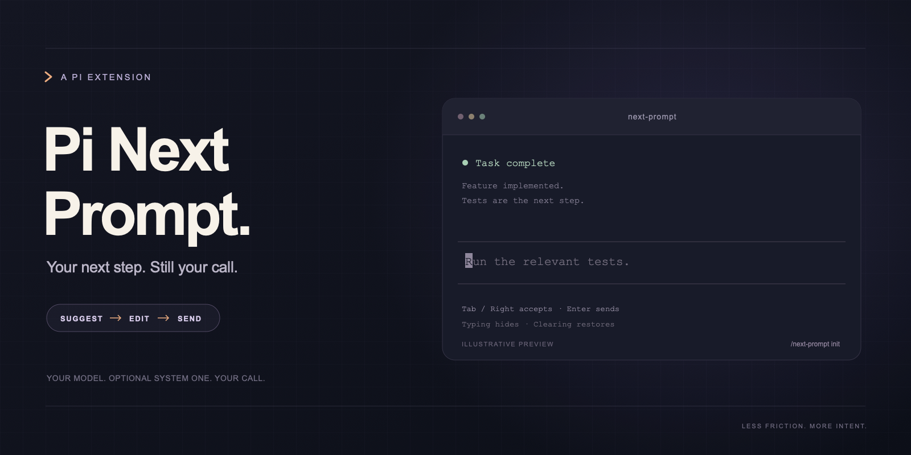

<p align="center">
  
</p>

# Pi Next Prompt

[简体中文](README.zh-CN.md) · [Configuration](docs/configuration.md) · [Debugging](docs/debugging.md)

Claude Code-style next-message suggestions for Pi. Your active model proposes a reply as it finishes answering. One suggestion appears as **dim ghost text inside the empty editor**.

- **Tab or Right** inserts the suggestion. Edit it or press Enter to send.
- **Typing hides it; clearing the editor brings it back.** No extra request.
- **Esc** dismisses it for the current turn.
- Request two or three suggestions to choose among them with **↑/↓**, then Tab/Right.

Nothing is sent or executed until you send the accepted draft. Suggestions never replace existing text.

## Get your first suggestion

```sh
pi install git:github.com/yuxiang-gao/pi-next-prompt
```

Restart Pi or run `/reload`, then:

```text
/next-prompt init
/next-prompt enable
```

Finish a task and leave the editor empty. If a useful reply is proposed, it appears at the cursor. One suggestion has no extra label; multiple suggestions use a compact list above the editor. Editors without a recognizable cursor use a dim fallback line.

`init` backs up an existing configuration before creating a disabled template. `enable` saves the switch immediately without calling a model. Configuration lives at `~/.pi/agent/next-prompt.json` (or under `PI_CODING_AGENT_DIR`). No classifier key is needed for the default `generate` mode.

Requires **Pi 1.3.0+**, Node.js **22.19+**, and an interactive terminal. Print/JSON/RPC sessions receive no suggestion instructions.

## How it works

In automatic `generate` or `hybrid` mode, a short named prompt section asks the **active conversation model** to end its normal answer with `<next>suggested reply</next>`. Multiple drafts use repeated tag lines. The extension strips this trailing metadata before storing the assistant answer and keeps the drafts in memory.

There is **no additional automatic chat-generation call**. The instruction and suggested text still consume tokens in the normal response. Tags can be briefly visible during streaming, then disappear when the message finishes. Generated metadata is removed from finalized assistant messages; the instruction remains ordinary system-prompt state.

Questions, choices and clarifications can all produce drafts. A model can also omit suggestions. Failed/aborted runs never offer them. Submission, new tasks, model/session/branch/context changes, disable and reload invalidate old offers; ordinary editing only hides them. Clearing an accepted draft can restore its offer until you send or dismiss it.

## Modes

| Mode | Automatic | Manual `/next-prompt suggest` |
| --- | --- | --- |
| `generate` (default) | Use `<next>` drafts from the normal answer | Make one fresh suggestion request to the active model |
| `classifier` | Jev selects your configured reply classes | Retry the same classification; no chat call |
| `hybrid` | Jev selects configured replies or actual `<next>` drafts | Generate fresh drafts with the active model, then evaluate them with Jev |

All generation uses the model selected in Pi. There is no separate generator-model picker. Classifier/hybrid use an independently configured System One endpoint and key. There are **no built-in reply classes**; define your options and meanings in config.

To use only manual suggestions, set `autoSuggest: false` and keep `enabled: true`. Normal turns then receive no suggestion instruction. Manual requests respect the selected mode and require a successful conversation, idle session and empty editor. They do not add a conversation turn, execute tools or send a message; fresh generation is a separate billable request. Usage for these requests is reported separately from the main answer.

## Commands

| Command | Action |
| --- | --- |
| `/next-prompt` or `/next-prompt status` | Show mode, readiness, offers and extra-request usage; preserve the current offer |
| `/next-prompt suggest` | Request fresh suggestions using the selected mode |
| `/next-prompt enable` / `/next-prompt disable` | Save and apply the master switch |
| `/next-prompt mode [generate\|hybrid\|classifier]` | Pick or set the strategy |
| `/next-prompt reload` | Apply manual config edits and invalidate old offers |
| `/next-prompt init` | Back up existing bytes, then create a fresh disabled template |

Old `generator` settings are ignored with migration guidance and removed when config is next saved. The legacy `/next-prompt model` command explains how to use Pi's `/model`; it makes no change.

See [configuration](docs/configuration.md) for classes, count and System One; [debugging](docs/debugging.md) for Jev scores and skipped offers.

## Install, update or remove

Try once without installing:

```sh
pi -e git:github.com/yuxiang-gao/pi-next-prompt
```

```sh
pi update git:github.com/yuxiang-gao/pi-next-prompt
pi remove git:github.com/yuxiang-gao/pi-next-prompt
```

Reload/restart Pi after changes. Removing the extension leaves your config and backups intact.

## Development

```sh
npm ci --ignore-scripts
npm run check
pi -e ./src/extension.ts
```

[Architecture and test guide](docs/development.md). No added runtime dependencies: Pi supplies its peer packages. Tests use local fixtures/HTTP servers; POSIX terminal smoke tests need `expect`. Neither cloud credentials nor paid requests are needed. Open reproducible issues at [yuxiang-gao/pi-next-prompt](https://github.com/yuxiang-gao/pi-next-prompt/issues), without keys or private conversation text.

## License

[MIT](LICENSE). Third-party source notices are in [THIRD_PARTY_NOTICES.md](THIRD_PARTY_NOTICES.md).

## Acknowledgements

The tagged next-message generation and Claude Code-style ghost-text interaction are inspired by [justmytwospence/pi-next-prompt](https://github.com/justmytwospence/pi-next-prompt) by **Spencer Boucher**. The editor rendering approach is adapted from that project under the MIT license. This redesign applied the simplicity guidance from [Ponytail](https://github.com/dietrichgebert/ponytail).
