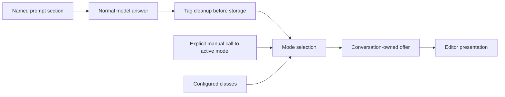

# Development

The extension separates draft production, offer lifetime and rendering without a framework or extra runtime dependencies. [CONTEXT.md](../CONTEXT.md) defines the vocabulary; [ADR 1](adr/0001-tagged-suggestions-and-offer-lifetime.md) records the chosen generation/lifetime design:

| File | Owns |
| --- | --- |
| `src/extension.ts` | Pi lifecycle, named prompt section, commands and usage |
| `src/tags.ts` | Shared draft policy, trailing tag extraction and assistant-message cleanup |
| `src/suggest.ts` | Bounded projected context, explicit same-model generation and configured Jev selection |
| `src/controller.ts` | Request/offer ownership, conversation validity and acceptance |
| `src/presentation.ts` | Existing-editor render decoration, ghost text and multiple-choice display |
| `src/config.ts` | Validation, private atomic writes and exact-byte init backups |
| `src/system-one.ts` | Authenticated bounded TypeSafe HTTP adapter |
| `src/debug.ts`, `src/onboarding.ts` | Private metadata traces and local readiness text |



Automatic `generate` never calls a chat model after settlement. `hybrid` gives Jev actual extracted proposals; `classifier` uses configured replies only. Manual generate/hybrid makes one suggestion-only request to the active model outside the session transcript. One parser and validation path handles both draft sources.

An offer's validity depends on the conversation, not an editor revision. Typing/history/paste hides it; empty input reveals it. Acceptance changes only the editor. Invalidation aborts owned work and disposes presentation; stale results cannot revive it. Rendering reads current focus, theme and width. The adapter restores its hook only when it still owns the editor render method, so another extension's later hook is not overwritten.

The active Pi TUI exposes the focused component at runtime; this is isolated in the presentation adapter with a guarded capability check. Cursor-less editors use a compact fallback. No editor replacement, polling loop, class registry or generic strategy framework is needed.

## Checks

```sh
npm run check
npm pack --dry-run
```

Tests are grouped by the source module they exercise, including regression cases. Parser tests cover trailing tags, partial/invalid metadata, fenced/inline examples, split text blocks and metadata preservation. Lifecycle tests cover cleanup before storage, enable/migration commands, manual-only behavior, failed/stale work and no implicit model changes. Offer/render tests cover hide/clear/restore, Tab/Right, selection, cursor markers and width. Real Pi terminal tests use a local provider and loopback Jev endpoint to verify acceptance, restoration, multiple selection, transcript cleanup and extra-call counts. On POSIX these need `expect`; CI installs it on Linux/macOS, while Windows skips the terminal cases.

Tests do not require cloud keys or paid calls. Validate terminal integration in both regular/fullscreen modes and with custom editors when changing cursor handling. See [debugging](debugging.md) for trace/ANSI logging.

## Source attribution

The interaction and editor-render decoration follow [Spencer Boucher's pi-next-prompt](https://github.com/justmytwospence/pi-next-prompt). Keep [THIRD_PARTY_NOTICES.md](../THIRD_PARTY_NOTICES.md) in distributed packages. [Ponytail](https://github.com/dietrichgebert/ponytail) guided this restructuring: delete obsolete flows, reuse Pi/platform facilities, and test the state and parsing logic that remains.
